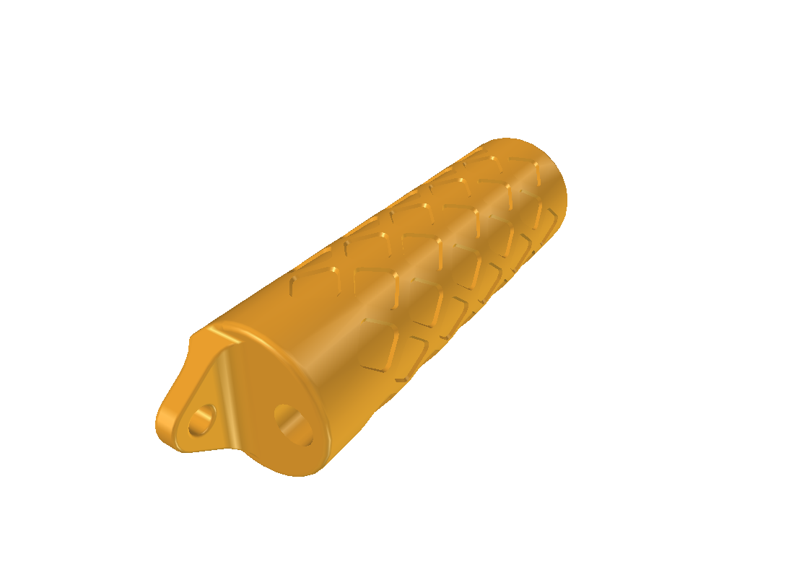
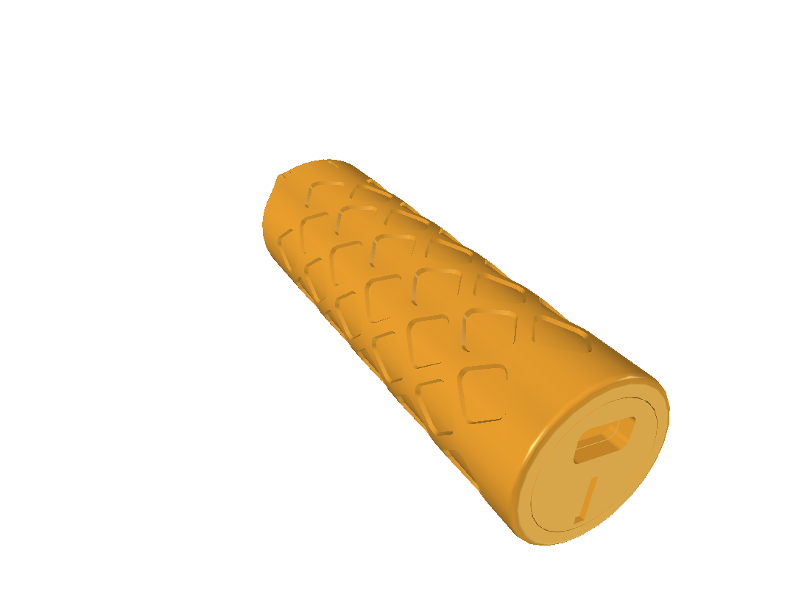
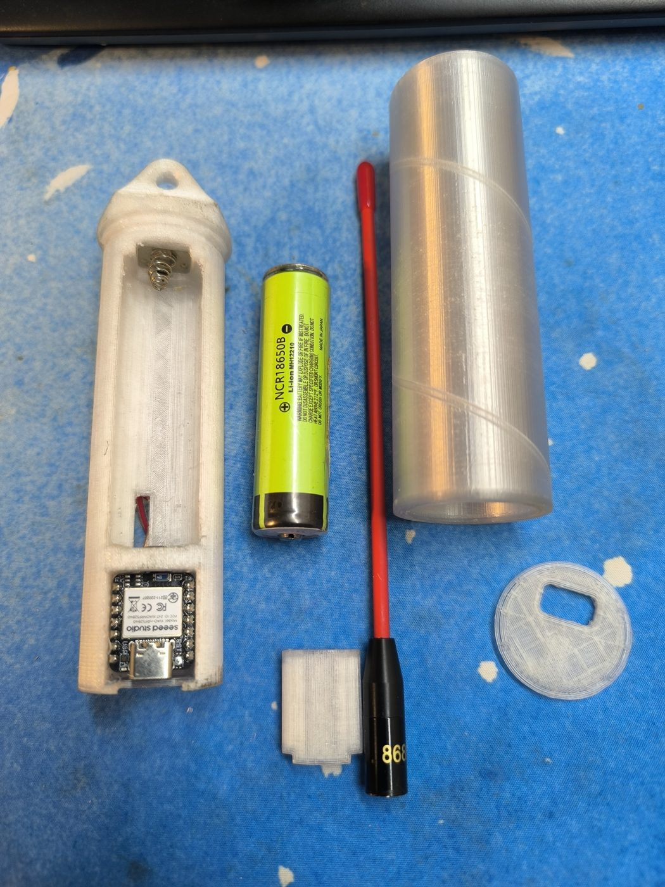
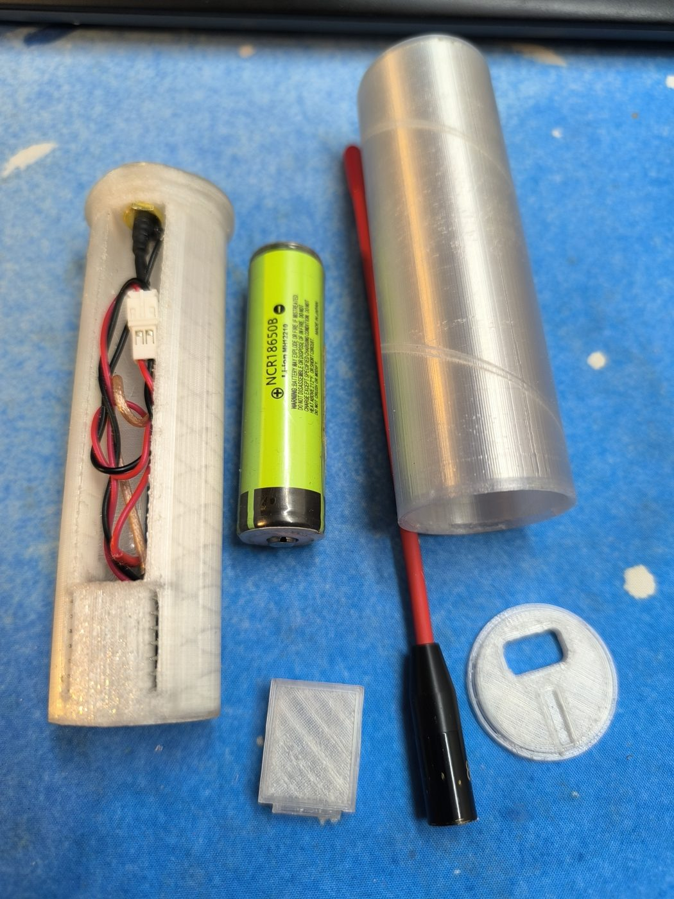
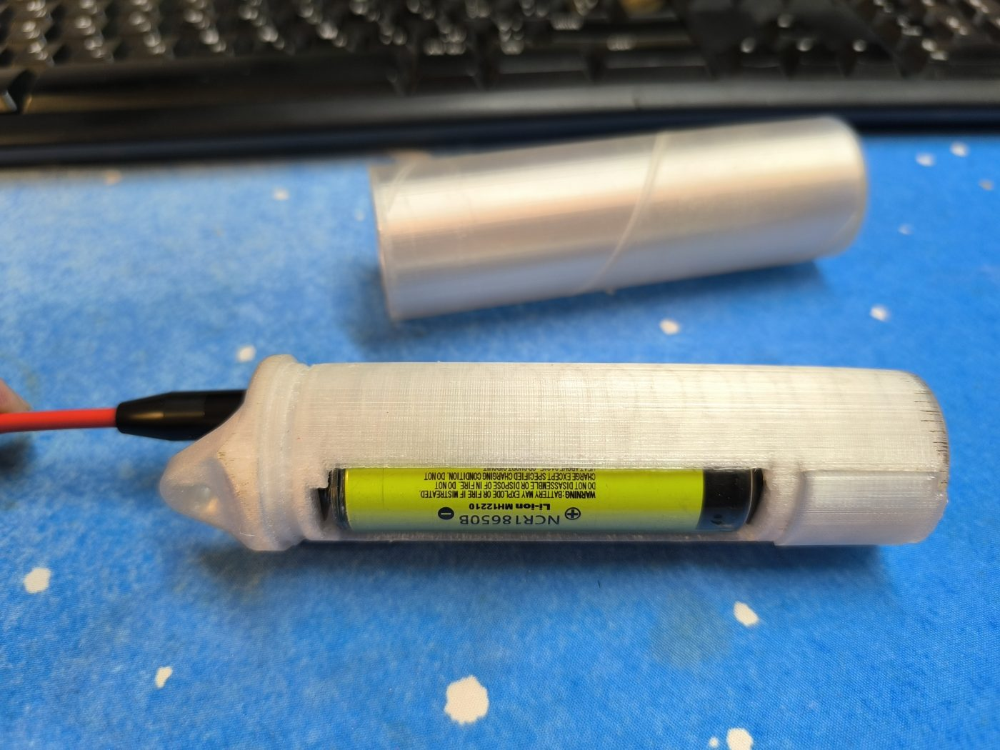
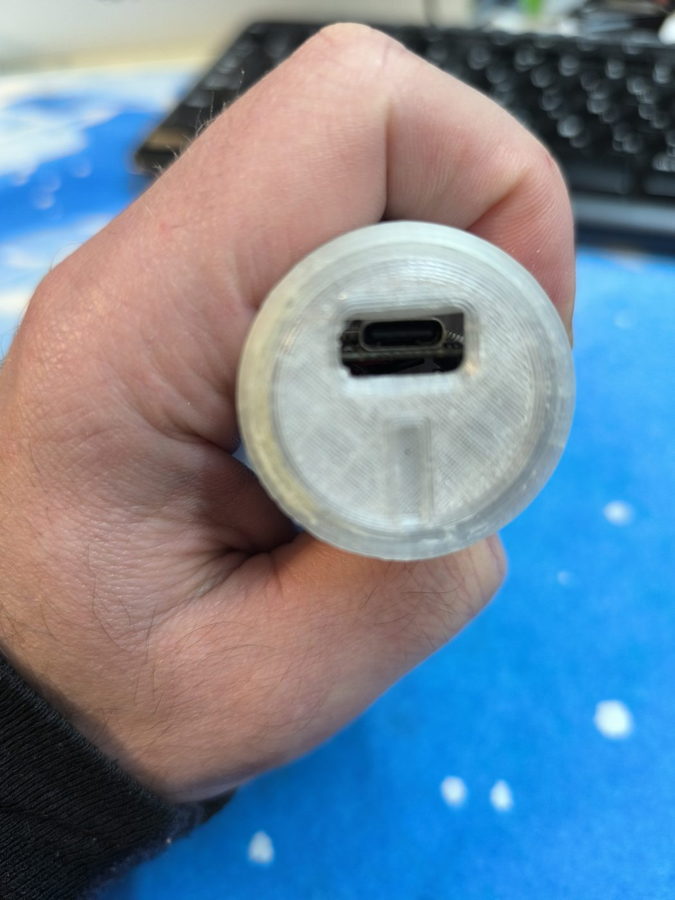
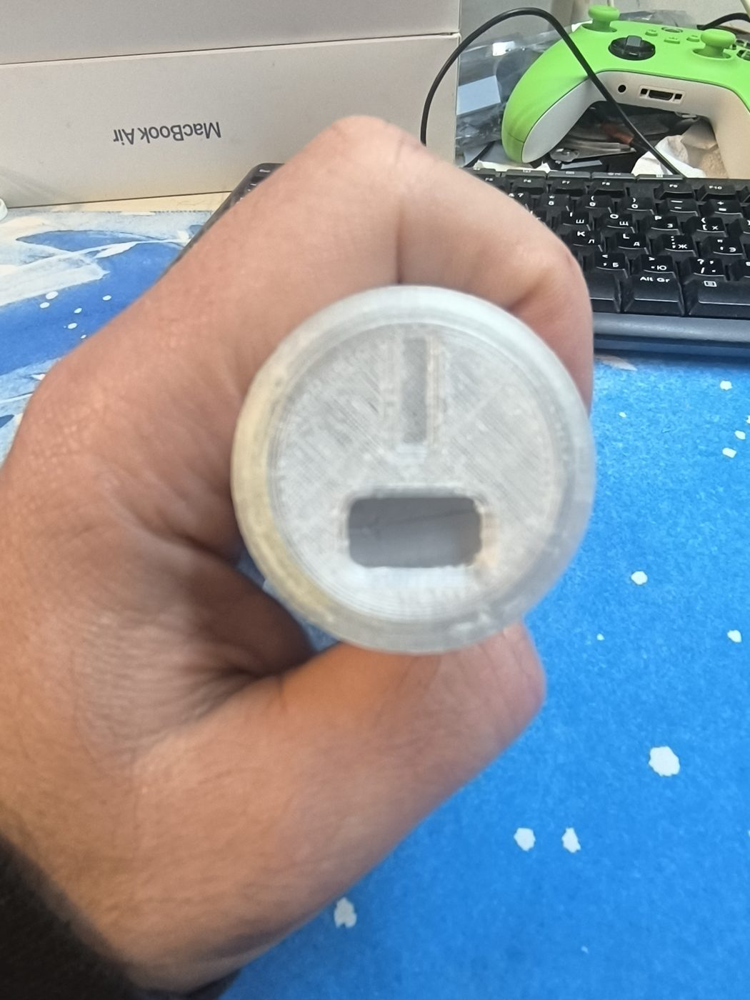
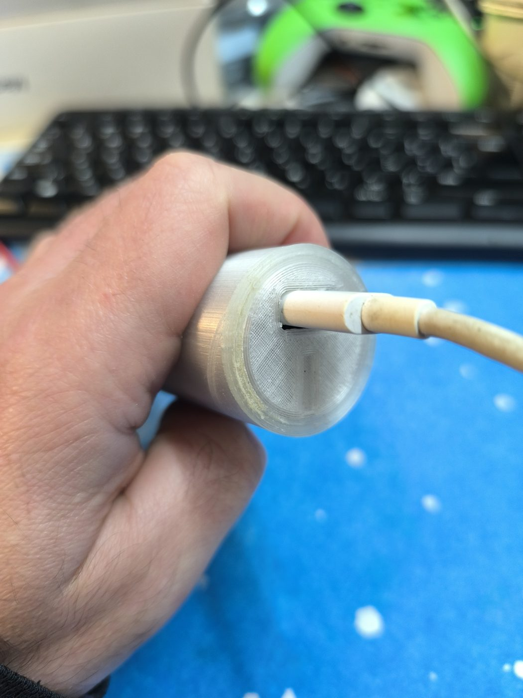
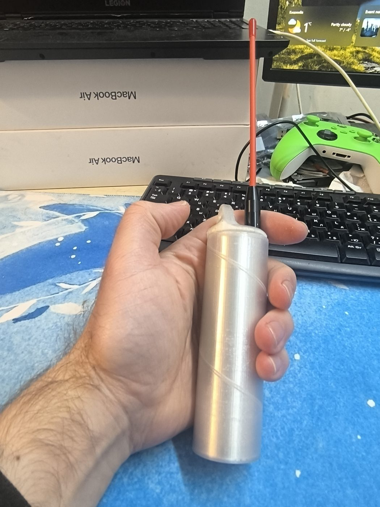
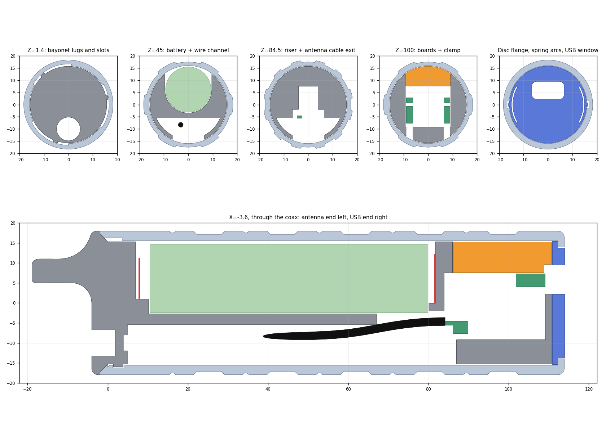

# XIAO + Wio-SX1262 18650 Tube Case

A pocket LoRa node enclosure for the **Seeed Studio XIAO nRF52840 + Wio-SX1262 kit** and one **18650 cell**, for [Meshtastic](https://meshtastic.org) and [MeshCore](https://meshcore.co.uk). It is a smooth Ø35 mm tube with an SMA antenna at one end, a rounded lanyard lug, and a USB-C port behind a turning disc at the other end.




> **Status: prototype v2.** The first print was assembled and almost everything fitted. The model now includes the fixes from that build: a 2 mm antenna wall, a snug antenna seat, a hex pocket for the SMA jack, a wire niche with side walls and a chunkier bayonet without the O-ring. **The STL files in `stl/` predate these fixes;** they will be re-exported once the model is final.

## Download / Скачать

> ⚠️ The STL files are from the first prototype and do not include the latest fixes yet (antenna seat, wire niche walls, chunkier bayonet). They will be updated once the model is final. / STL пока от первого прототипа, без последних правок.

**Files to print** — click a link and the file downloads:

| Part / Деталь | STL |
| --- | --- |
| Chassis / шасси | [xiao_wio_18650_tube_case_chassis.stl](https://github.com/ssserghei/xiao-wio-18650-tube-case/raw/main/stl/xiao_wio_18650_tube_case_chassis.stl) |
| Sleeve / гильза | [xiao_wio_18650_tube_case_sleeve.stl](https://github.com/ssserghei/xiao-wio-18650-tube-case/raw/main/stl/xiao_wio_18650_tube_case_sleeve.stl) |
| Board clamp / прижимная вставка | [xiao_wio_18650_tube_case_board_clamp.stl](https://github.com/ssserghei/xiao-wio-18650-tube-case/raw/main/stl/xiao_wio_18650_tube_case_board_clamp.stl) |
| USB-C disc / диск USB-C | [xiao_wio_18650_tube_case_shutter.stl](https://github.com/ssserghei/xiao-wio-18650-tube-case/raw/main/stl/xiao_wio_18650_tube_case_shutter.stl) |

**Everything at once / всё одним архивом:** [download ZIP](https://github.com/ssserghei/xiao-wio-18650-tube-case/archive/refs/heads/main.zip) — the STL files are in the `stl` folder inside.

**To change the model / чтобы менять модель:** [xiao_wio_18650_tube_case.FCStd](https://github.com/ssserghei/xiao-wio-18650-tube-case/raw/main/cad/xiao_wio_18650_tube_case.FCStd), opens in [FreeCAD](https://www.freecad.org/downloads.php) 1.1 or newer.

**Free programs / бесплатные программы:**
- Slicer to turn STL into a print file: [PrusaSlicer](https://www.prusa3d.com/page/prusaslicer_424/) or [Cura](https://ultimaker.com/software/ultimaker-cura/).
- CAD to edit the model: [FreeCAD](https://www.freecad.org/downloads.php).

**Electronics / электроника:**
- XIAO nRF52840 + Wio-SX1262 kit: [Seeed Studio](https://www.seeedstudio.com) — search the shop for "XIAO nRF52840 Wio-SX1262 kit".
- Firmware: [Meshtastic web flasher](https://flasher.meshtastic.org) or [MeshCore flasher](https://flasher.meshcore.co.uk).
- Everything else is listed under [Parts list](#parts-list) with the sizes to search for.

## First prototype

Printed in PETG on an Ender-3 and assembled with a real XIAO + Wio-SX1262 stack, an 18650 cell and an 868 MHz whip antenna. Almost everything fitted at the first try; the fixes it showed are already in the model.

<p>
  
  
  
</p>
<p>
  
  
  
  
</p>

## Features

- **Flush body, Ø36.6 mm over the ribs.** No steps or exposed thread; only a thin seam at the antenna end.
- **Raised diamond lattice.** 0.8 mm ribs at 45° over the sleeve, six large diamonds around, between solid bands at both ends. Cells have rounded corners and 30° walls, so dirt wipes out instead of packing into corners. It grips like a knurl and stiffens the sleeve; the rear band doubles the wall over the bayonet slots.
- **Reverse-battery guard.** The plus plate is glued 0.5 mm behind the end wall of the battery pocket, in an open window narrower than the cell. A battery put in backwards rests its flat end on the wall beside the window and does not touch the plate; the plus button of a button-top cell reaches it. Flat-top cells will not make contact.
- **Polarity and position marks.** "+" and "−" engraved on both sides of the chassis by the contacts. A line on the sleeve meets one groove on the flange when locked and two grooves when it is time to push the sleeve on or pull it off.
- **Finger scoop** at the plus end of the battery window, for lifting the cell out.
- **Three-start helical bayonet, sized for coarse printers.** Lugs 2.4 mm thick and 45° wide with 0.2–0.25 mm clearance; a 40° turn pulls the chassis tight against the sleeve. Turn clockwise, seen from the antenna end, to close.
- **USB-C behind a recessed disc.** Turn it 180° to open or close the port. Two spring detents hold each position.
- **No power switch.** Inserting the battery powers the node.
- **Straight antenna coax.** The board stack sits low, so the U.FL pigtail runs straight from the Wio module to the SMA connector and is not levered off by a bend.
- **Lanyard lug** on the antenna end, Ø6 mm hole for a cord or a small carabiner.
- **Splash resistant, not waterproof.** There is no O-ring: printed PETG is porous, so a ring would not make the case tight.

## Parts list

| Part | Notes |
| --- | --- |
| Seeed XIAO nRF52840 + Wio-SX1262 kit | Stack with pin headers, about 21 mm tall including 4.35 mm of pins under the Wio |
| 18650 cell | Flat top, designed for Ø18.6 × 69.3 mm |
| Battery contacts | AA-holder style plates, 13 mm wide: plus 12.1 mm tall, minus 10 mm tall with a conical spring. They are glued in place |
| SMA bulkhead jack + U.FL pigtail | 1/4-36 thread (Ø6.2 mm measured), thread length at least 11 mm, hex flange and nut about 8 mm across flats, cable up to Ø2 mm |
| Wire | About Ø1.5 mm insulated, for battery to XIAO; the solder wells take a Dupont crimp |
| Glue | For the contact plates |
| Optional: U.FL clamp | [Xiao nRF52840 & Wio-SX1262 antenna clamp](https://www.printables.com/model/1761740-xiao-nrf52840-wio-sx1262-antenna-clamp) by dreimal_8, keeps the U.FL seated |

Tools: soldering iron, thin-walled 8 mm box spanner or nut driver (outer diameter under 9.5 mm) for the SMA nut, small file.

## Printing

STL files in [`stl/`](stl) are already oriented for printing.

| File | On the bed | Supports | Time* | Filament* |
| --- | --- | --- | --- | --- |
| `…_board_clamp.stl` | flat side down | none | 17 min | 2 g |
| `…_shutter.stl` (USB disc) | flange down | none | 14 min | 2 g |
| `…_sleeve.stl` | inner lip down | none, 6 mm brim | 3 h 17 min | 22 g |
| `…_chassis.stl` | lying, battery window up | from build plate only, 6 mm brim | 4 h 33 min | 41 g |

\*PrusaSlicer 2.9.6, Creality Ender-3, 0.4 mm nozzle, 0.2 mm layers, Generic PETG (240/70 °C).

- **Material:** PETG. Clearances are 0.3 mm per side.
- **Print order:** the clamp and the disc first. They are quick and show whether the clearances suit your printer.
- **Chassis:** print it standing on its USB end, without supports. The flange face under the sleeve is a 45° cone for this. Inside, the ends of the battery and board pockets and the plate slots print as bridges of up to about 21 mm: keep bridging enabled and check them in the layer preview.
- **Sleeve:** tall and thin-walled (1.5 mm). Keep the speed moderate. Set *Seam position* to *Rear* for one straight seam line instead of a spiral.

## Assembly

1. Solder wires to the contact tabs, drop the tabs into the wells and glue the plates to their flat walls.
2. Feed the SMA jack from the wire channel through the rear hole; its hex flange drops into a 1 mm hex pocket, so it cannot turn. Tighten the nut at the bottom of the outer recess. The antenna base (Ø9.56 mm) then sits slightly tight in the same recess.
3. Route the battery wires and the coax along the channel and up behind the boards. Side pockets under the battery hold spare wire; their outer walls keep it in while the sleeve goes on. Solder the wires to the XIAO and plug in the U.FL.
4. Drop the board stack into its pocket from the top, USB-C into the front window. Lay the clamp on top; its tongue closes the slot above USB-C.
5. Insert the battery: the node powers up.
6. Push the disc into the sleeve from the rear until it stops at the lip. Slide the chassis in USB end first, line up the lugs with the slots and turn 40° clockwise, seen from the antenna end, until it tightens.
7. Turn the disc with a fingernail or a coin in its face slot: window over the port is open, 180° away is closed.

## Things to check on the first print

- Bayonet: torque to close, and whether it stays tight.
- USB disc: how easily it turns and whether the detents hold.
- Minus spring at 2 mm working height: it must not bottom out.
- Board stack: whether it shifts forward when a cable is pulled out.
- SMA: the clamped wall is 2 mm and about 7 mm of thread is left for the antenna; the hex pocket assumes a flange about 8 mm across flats.

Planned changes after the first print are listed in [TODO.md](TODO.md).

## Editing the model

The source is [`cad/xiao_wio_18650_tube_case.FCStd`](cad/xiao_wio_18650_tube_case.FCStd), FreeCAD 1.1.3. Units are millimetres.

- **Axes:** Z runs from the antenna end (negative Z, flange and lug) to the USB end. +Y is up, the side where the battery and boards are inserted.
- **Parameters:** most dimensions live in the `Parameters` spreadsheet and drive the parts through expressions. Change a value there and recompute.
- **Printed parts:** `ChassisFinal`, `SleeveFinal`, `BoardClamp`, `Shutter`. Everything else is a cutting tool or a reference dummy.
- **Static shapes:** the helical bayonet, the rib lattice, the antenna cable dummy and the marks are computed shapes, and some fillets refer to edge numbers. After changing a parameter, run `scripts/rebuild_static.py` with `freecadcmd`: it rebuilds all of them from the sheet and saves.

Scripts in [`scripts/`](scripts) run with FreeCAD's console:

```bash
freecadcmd scripts/check_stage_29_32.py
```

- `check_stage_29_32.py` checks every printed part against the battery, contacts, board stack, coax and each other: valid single solids, no overlaps, free insertion paths, bayonet travel, USB plug path, closed disc.
- `export_stl.py` writes the STL files and refuses to write a mesh that is not clean.
- `render_sections.py` draws [`renders/sections.png`](renders/sections.png).
- `set_view_in_gui.py` and `snapshot_gui.py` run with the FreeCAD GUI (`freecad scripts/…`) from the repository root.
- `apply_*.py` record how the model was built step by step. They expect the document as it was before each step, so they cannot be replayed on the finished file.

`freecadcmd` exits with code 0 even when a script fails. A check has passed only when its `…_CHECK=` line appears in the output.



The design log, in Russian, with every stage and decision is in [`docs/design-log-ru.md`](docs/design-log-ru.md).

## Credits

- Board stack reference model: [XIAO nRF52840 & Wio-SX1262 Kit 3D model](https://www.printables.com/model/1831794-xiao-nrf52840-wio-sx1262-kit-3d-model) by zuberio, CC0. Copied to [`reference/`](reference) and embedded in the FreeCAD file as a dummy; it is not part of the printed case.
- Inspiration: [Tube Case for Seeed Studio XIAO nRF52840 & Wio-SX1262](https://www.printables.com/model/1636351-tube-case-for-seeed-studio-xiao-nrf52840-wio-sx1262-meshtastic-meshcore) and [Meshtastic Seeed Studio XIAO nRF52 SX1262 Case](https://www.printables.com/model/1346041-meshtastic-seeed-studio-xiao-nrf52-sx1262-case) by verdi. No geometry was copied from them.
- Designed in FreeCAD by Serghei S.S. with Claude Code.

## License

See [LICENSE](LICENSE).

## Кратко по-русски

Корпус-труба Ø35 мм для Seeed XIAO nRF52840 + Wio-SX1262 и аккумулятора 18650, для Meshtastic и MeshCore. Гладкая гильза, винтовой байонет на три захода, SMA-антенна и проушина для шнурка с одной стороны, USB-C за поворотным диском с другой. Выключателя нет: вставил батарею — узел работает. Печать: PETG, сопло 0,4 мм. Прототип, ещё не проверен примеркой. Подробный журнал разработки — в [`docs/design-log-ru.md`](docs/design-log-ru.md).
